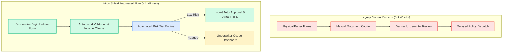

# Milestone 1: Problem Definition and Scope
## Automated Microinsurance Enrollment Platform

---

### 1. Real-Time Need Analysis
Over 2.5 billion individuals globally work in informal sectors—smallholder agriculture, handicraft weaving, daily construction labor, and street retail. These vulnerable segments frequently suffer severe economic destitution due to unforeseen shocks: crop failure, livestock epidemics, acute medical hospitalization, or workplace accidents.

Traditional commercial insurance fails this demographic due to:
* **High Transaction Costs:** Manual paperwork, agent commissions, and physical branch audits make low-premium policies economically unviable for insurers.
* **Prolonged Turnaround Times:** Manual underwriting takes between 14 to 30 days.
* **Low Financial Literacy & Accessibility Barriers:** Complex multi-page policy wordings discourage informal workers.
* **Lack of Real-Time Transparency:** Applicants have no visibility into enrollment progress, leading to distrust.

The **Automated Microinsurance Enrollment Platform (MicroShield)** addresses this critical void by digitizing and automating the complete enrollment lifecycle: rapid digital intake, automated rule-based risk evaluation, instant auto-approval for qualified low-risk applicants, transparent status tracking, and continuous underwriting compliance.

---

### 2. Target User Personas
| Persona | Demographics / Profile | Primary Needs & Behavioral Traits |
| :--- | :--- | :--- |
| **Rural Smallholder Farmer** | Age 25–55, low digital literacy, irregular seasonal income. | Needs simple registration, low monthly premium ($2–$5), quick crop micro-protection against monsoon failure. |
| **Informal Artisan / Craftsman** | Age 20–60, urban/peri-urban handicraft worker. | Needs basic accident and hospitalization cash coverage with instant digital confirmation. |
| **Field Agent / NGO Worker** | Operates handheld devices or shared community kiosks. | Needs fast, error-free mobile-responsive data entry, offline-ready UI, and instant duplicate detection. |
| **Underwriting Desk Officer** | Professional risk auditor at partner insurance company. | Needs a centralized dashboard to inspect flagged edge cases, verify credentials, and approve/reject with notes. |
| **DevOps & Platform Admin** | Technical engineer managing availability and deployments. | Needs containerized microservices, automated CI/CD pipelines, health probes, and zero-downtime rollbacks. |

---

### 3. Existing Pain Points & Solution Mapping


---

### 4. Stakeholder Matrix
* **Primary Beneficiaries:** Farmers, daily wage laborers, self-employed artisans, micro-entrepreneurs.
* **Insurance Underwriting Partners:** Actuaries, risk compliance managers, claim evaluators.
* **Channel Partners:** Microfinance institutions (MFIs), rural post offices, agricultural cooperatives.
* **Regulatory Authorities:** Insurance Regulatory and Development Authorities (IRDAI, NAIC, IAIS).
* **Technical Operations Team:** DevOps engineers, cloud architects, site reliability engineers (SREs).

---

### 5. Platform Objectives & Measurable Success Criteria
1. **Intake Speed:** Reduce participant application time from 45 minutes of paperwork to **under 2 minutes** on web/mobile.
2. **Instant Underwriting:** Achieve **>= 70% automated instant approval** for low-risk applicants meeting predefined policy bounds.
3. **Data Integrity:** **0% duplicate policy enrollments** through automated National ID validation constraints.
4. **DevOps Pipeline Efficiency:** 100% automated build, test, and containerized deployment via Jenkins pipeline with under 5 minutes cycle time.
5. **System Reliability:** Maintain **>= 99.9% uptime** validated via automated health probes and Ansible recovery scripts.

---

### 6. Approved 15-Task MVP Scope
To guarantee a focused, high-impact initial release, the scope is frozen into exactly **15 discrete engineering tasks**:

```
[TASK-01] Problem Definition, Requirements Engineering & Scope Freeze
[TASK-02] Agile Sprint Planning, User Stories, DoD & DevOps Workflow Architecture
[TASK-03] Technical Architecture Design, Technology Stack Selection & DB Schema
[TASK-04] Git Repository Initialization, Branching Policies & SCM Baseline
[TASK-05] Domain Entity Models, Enums & JPA Repositories Implementation
[TASK-06] Core Business Service: Automated Validation & Risk Tier Engine
[TASK-07] Feature 1: Participant Registration REST API & Form UI (feature/applicant-registration)
[TASK-08] Feature 2: Underwriting Desk Approval/Rejection Workflow (feature/underwriting-approval)
[TASK-09] Git Merge Conflict Simulation, Resolution & v1.0.0 Tagging
[TASK-10] Participant Directory, Search/Filter & Live Tracking Portal UI
[TASK-11] Unit Testing Suite with JUnit 5 & Business Rule Assertions
[TASK-12] Automated End-to-End Selenium WebDriver Test Suite with Screenshot Mechanism
[TASK-13] Multi-Stage Dockerfile, Container Lifecycle & Docker Compose Setup
[TASK-14] Declarative Jenkins CI/CD Pipeline as Code (Build, Test, Image, Deploy, Healthcheck)
[TASK-15] Ansible Configuration Management Playbook, Idempotent Provisioning & Rollback Strategy
```
