# Milestone 2: Agile Planning and DevOps Workflow
## Automated Microinsurance Enrollment Platform

---

### 1. User Stories & Acceptance Criteria

#### User Story 1 (US-01): Low-Risk Instant Participant Registration
* **As a:** Rural Agricultural Field Agent
* **I want to:** Rapidly register smallholder farmers through a responsive digital form and receive instant automated approval for low-risk applicants
* **So that:** The farmer receives immediate coverage against monsoon risks without traveling to district branch offices.
* **Acceptance Criteria:**
  - [x] Given valid applicant details with annual income <= $40,000, age 18–50, and standard coverage <= $5,000.
  - [x] When the agent submits the form, the system immediately returns an alphanumeric Reference Number (`MIP-YYYY-XXXXX`).
  - [x] The application status is automatically flagged as `AUTO_APPROVED` with risk tier `LOW_RISK`.
  - [x] Response time for submission and decision is under 1.5 seconds.

#### User Story 2 (US-02): Duplicate National ID Prevention
* **As a:** Platform Compliance Officer
* **I want to:** Prevent duplicate insurance enrollments using the applicant's unique National ID
* **So that:** Subsidized government microinsurance benefits are not fraudulently claimed multiple times.
* **Acceptance Criteria:**
  - [x] Given an existing active policy with National ID `AID-9821453210`.
  - [x] When a second application is submitted with the identical National ID.
  - [x] Then the platform blocks the submission with HTTP 400 Bad Request and an explicit error message: `"An application with National ID already exists in the platform."`

#### User Story 3 (US-03): Underwriting Desk Review Queue
* **As an:** Underwriting Officer
* **I want to:** Inspect applications flagged by the automated risk engine as `UNDER_REVIEW`
* **So that:** I can audit demographic anomalies, verify secondary documentation, and record formal approval or rejection remarks.
* **Acceptance Criteria:**
  - [x] System displays a dedicated Underwriting Desk listing all pending applications.
  - [x] Displays the specific flagged reason (e.g. age > 60, higher coverage, or elevated income).
  - [x] Provides single-click `Approve` and `Reject` actions capturing officer audit notes.
  - [x] State transition updates the database and reflects immediately on public tracking.

#### User Story 4 (US-04): Participant Self-Service Status Tracking
* **As an:** Enrolled Participant / Beneficiary
* **I want to:** Query my policy enrollment status using my Reference ID or Mobile Number
* **So that:** I have complete visibility into my active coverage, guaranteed benefits, and nominee records.
* **Acceptance Criteria:**
  - [x] Public lookup input accepts reference number (e.g. `MIP-2026-CRP01`).
  - [x] Renders a multi-step progression timeline: Submitted -> Automated Evaluation -> Underwriting Decision -> Active Policy Pass.
  - [x] Renders a printable/downloadable digital policy summary certificate.

#### User Story 5 (US-05): Continuous Integration & Deployment Pipeline
* **As a:** DevOps Engineer
* **I want to:** Automate code linting, unit testing, Selenium E2E validation, Docker packaging, and container deployment upon every commit
* **So that:** Releases are rapid, reproducible, zero-defect, and automatically rolled back if health checks fail.
* **Acceptance Criteria:**
  - [x] Every Git push triggers the Jenkins declarative pipeline.
  - [x] Failing tests automatically halt deployment before artifact generation.
  - [x] Successful builds create a version-tagged Docker image and deploy to target environment.

---

### 2. 15-Task Product Backlog & Kanban Plan

| Task ID | Task Description | User Story | Priority | Story Points | Kanban State |
| :--- | :--- | :--- | :--- | :---: | :---: |
| **TASK-01** | Problem definition, stakeholder matrix & scope freeze | All | High | 3 | **DONE** |
| **TASK-02** | Agile backlog, sprint schedule, DoD & DevOps workflow diagram | All | High | 5 | **DONE** |
| **TASK-03** | System architecture, ER data model, API contracts & tech stack setup | All | High | 5 | **DONE** |
| **TASK-04** | Git repo initialization, `.gitignore`, issue templates & branch policy | US-05 | High | 3 | **DONE** |
| **TASK-05** | Domain model (Entities, Enums: `PolicyType`, `EnrollmentStatus`, `RiskTier`) | US-01, US-03 | High | 5 | **DONE** |
| **TASK-06** | Automated Business Rules Engine (Age, Income cap, Duplicate ID, Risk scoring) | US-01, US-02 | High | 8 | **DONE** |
| **TASK-07** | Feature 1: Participant Registration REST API & Responsive Intake Form | US-01 | High | 8 | **DONE** |
| **TASK-08** | Feature 2: Underwriting Desk Review Queue & Audit Decision API | US-03 | High | 8 | **DONE** |
| **TASK-09** | Git collaboration: Feature branching, conflict simulation & resolution | US-05 | Medium | 5 | **DONE** |
| **TASK-10** | Participant Directory, real-time filters & Status Tracking Portal UI | US-04 | High | 8 | **DONE** |
| **TASK-11** | Unit testing suite with JUnit 5 & Mockito test coverage | US-01, US-02 | High | 5 | **DONE** |
| **TASK-12** | Automated Selenium WebDriver E2E test suite with screenshot capture | US-01, US-04 | High | 8 | **DONE** |
| **TASK-13** | Multi-stage Dockerfile, image optimization & container lifecycle | US-05 | High | 5 | **DONE** |
| **TASK-14** | Jenkins declarative CI/CD pipeline (Checkout -> Build -> Test -> Deploy) | US-05 | High | 8 | **DONE** |
| **TASK-15** | Ansible configuration management playbook, idempotency & rollback | US-05 | High | 8 | **DONE** |

---

### 3. Definition of Done (DoD)
A backlog task is only considered **DONE** when it meets all the following non-negotiable criteria:
1. **Code Completeness:** Source code adheres to project style guidelines, clean architecture, and includes clear Javadoc/comments.
2. **Unit Test Coverage:** All core business logic and validation edge cases are covered by JUnit 5 tests with 100% passing results.
3. **Automated Testing:** Selenium WebDriver E2E journeys execute successfully without unhandled exceptions.
4. **Static Analysis & Build:** Code compiles cleanly with zero compiler warnings via `mvn clean package`.
5. **Continuous Integration:** Changes are merged to `develop`/`main` through peer-reviewed pull requests and pass the Jenkins CI pipeline.
6. **Containerization:** Application packages cleanly into an unprivileged Docker image that satisfies the container health check probe.
7. **Idempotency:** Ansible deployment scripts can execute repeatedly without causing unintended state modifications.
8. **Documentation:** Architecture diagrams, API specs, and runbooks are updated in the `docs/` repository directory.

---

### 4. DevOps Lifecycle Architecture Diagram

```mermaid
flowchart LR
    subgraph Plan_Code["1. Plan & Code"]
        A1["Agile Backlog<br/>(15 Tasks)"] --> A2["Local Dev<br/>(Java 21 / Spring Boot)"]
        A2 --> A3["Git Feature Branch<br/>(feature/*)"]
    end

    subgraph CI_Pipeline["2. Continuous Integration (Jenkins)"]
        A3 --> B1["Pull Request & Merge<br/>(develop)"]
        B1 --> B2["Jenkins Webhook Trigger"]
        B2 --> B3["Maven Compile &<br/>JUnit 5 Suite"]
        B3 --> B4["Selenium Headless<br/>Chrome E2E Suite"]
    end

    subgraph Container_CD["3. Containerize & Continuous Delivery"]
        B4 --> C1["Multi-Stage<br/>Docker Build"]
        C1 --> C2["Version Tagging<br/>(e.g. :1.0.0)"]
        C2 --> C3["Registry Push<br/>(Docker Hub / Local)"]
    end

    subgraph Config_Ops["4. Provisioning & Operations"]
        C3 --> D1["Ansible Playbook<br/>(Idempotent Node Config)"]
        D1 --> D2["Target Server Deploy<br/>(Tomcat / Docker)"]
        D2 --> D3["Health Check Probe<br/>(/api/health)"]
        D3 -->|Fails| D4["Automated Rollback<br/>(rollback.yml)"]
        D3 -->|Passes| D5["Continuous Monitoring<br/>(Actuator Metrics)"]
    end

    style Plan_Code fill:#eff6ff,stroke:#3b82f6
    style CI_Pipeline fill:#f0fdf4,stroke:#22c55e
    style Container_CD fill:#fefce8,stroke:#eab308
    style Config_Ops fill:#faf5ff,stroke:#a855f7
```

