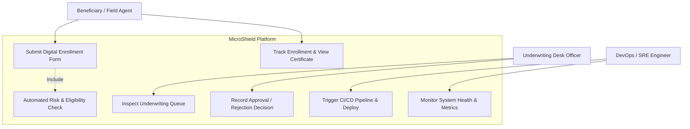
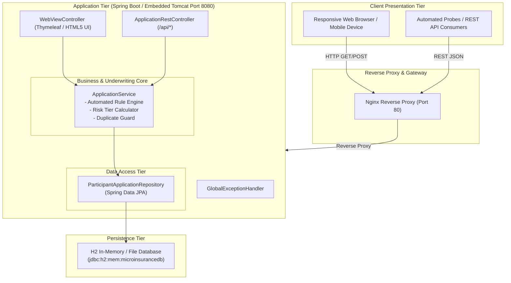
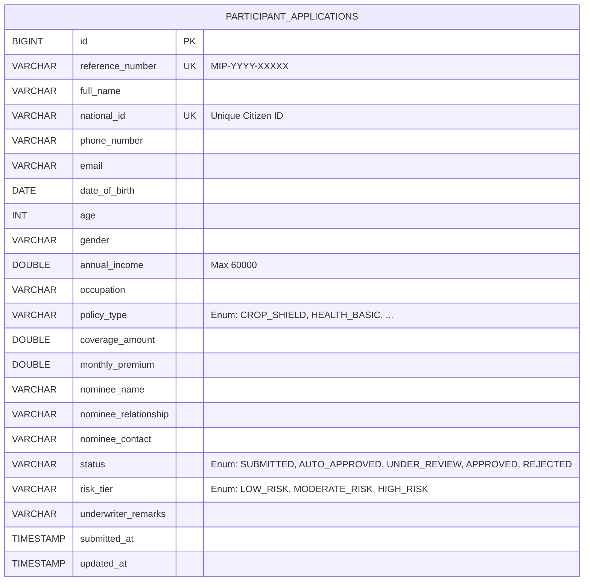

# Milestone 3: Requirements, Architecture and Technology Setup
## Automated Microinsurance Enrollment Platform

---

### 1. Software Requirements Specification (SRS) Summary

#### 1.1 Functional Requirements (FR)
* **FR-01: Participant Intake & Registration:** System shall capture applicant demographics (Name, National ID, Mobile, Email, DOB, Gender), socio-economic data (Annual Household Income, Occupation), and Nominee details.
* **FR-02: Policy Configuration:** System shall support multiple microinsurance tiers:
  * Crop Micro-Protection ($120/mo, $3,000 coverage)
  * Artisan Health Shield ($180/mo, $5,000 coverage)
  * Livestock Micro-Coverage ($150/mo, $4,000 coverage)
  * Daily Wage Accident & Disability ($90/mo, $2,500 coverage)
* **FR-03: Automated Rules & Risk Scoring Engine:**
  * Age validation: Reject applications where age < 18 or > 65.
  * Income threshold: Reject applicants exceeding $60,000 annual income (refer to commercial plans).
  * Auto-approval: Automatically approve applicants with Low Risk (`LOW_RISK`: age <= 50, income <= $40,000, coverage <= $5,000).
  * Manual Audit Flagging: Route applicants to `UNDER_REVIEW` if moderate/high risk.
* **FR-04: Duplicate Enrollment Prevention:** Unique database constraint on `national_id` ensures no applicant holds multiple active subsidized policies.
* **FR-05: Underwriter Review Queue:** Underwriting officers can view pending applications, examine audit reason flags, and record decisions (`APPROVED`/`REJECTED`) with notes.
* **FR-06: Status Tracking & Policy Certificate:** Applicants can track their lifecycle progress using their Reference ID and view digital insurance passes.
* **FR-07: Health & Monitoring Endpoint:** Provide `/api/health` and `/actuator/health` exposing platform liveness, uptime, and database metrics.

#### 1.2 Non-Functional Requirements (NFR)
* **NFR-01 (Performance):** Average REST API response time < 200ms; end-to-end form submission with auto-approval < 1500ms.
* **NFR-02 (Availability & Reliability):** 99.9% uptime target backed by automated health check probes and instant recovery scripts.
* **NFR-03 (Security):** Non-root unprivileged execution inside Docker containers; input sanitization and parameterized SQL via JPA/Hibernate.
* **NFR-04 (Portability & Idempotency):** Multi-stage containerized build run on any OCI-compliant runtime; idempotent Ansible provisioning for target hosts.

---

### 2. Use-Case Diagram


---

### 3. Application Architecture Diagram


---

### 4. Data Model (Entity-Relationship)


---

### 5. API Specification Matrix
| Method | Endpoint Path | Description | Request Payload / Params | Status Code |
| :--- | :--- | :--- | :--- | :---: |
| `POST` | `/api/applications` | Submit new participant enrollment | `EnrollmentRequestDto` (JSON) | `201 Created` |
| `GET` | `/api/applications` | List enrolled participants with filters | `status`, `policyType`, `search` | `200 OK` |
| `GET` | `/api/applications/{id}` | Retrieve application details by DB ID | Path variable `id` | `200 OK` |
| `GET` | `/api/applications/track/{ref}` | Public status tracking lookup | Path variable `ref` | `200 OK` |
| `POST` | `/api/applications/{id}/decision` | Record underwriter audit decision | `ApprovalDecisionDto` (JSON) | `200 OK` |
| `GET` | `/api/metrics` | Aggregate enrollment dashboard counts | None | `200 OK` |
| `GET` | `/api/health` | Automated readiness & liveness probe | None | `200 OK` |
| `GET` | `/actuator/health` | Spring Boot Actuator monitoring | None | `200 OK` |

---

### 6. Working Local Setup Guide
1. **Prerequisites:**
   * Java Development Kit (JDK) 21 LTS installed (`java -version`).
   * Git installed (`git --version`).
   * Google Chrome or MS Edge (for Selenium tests).
2. **Clone & Build:**
   ```bash
   cd c:\College\Projects\microinsurance-enrollment-platform
   .\mvnw.cmd clean package
   ```
3. **Run Application Locally:**
   ```bash
   java -jar target\microinsurance-enrollment-platform-1.0.0.jar
   ```
4. **Access Endpoints:**
   * Web Portal: `http://localhost:8080/`
   * H2 Console: `http://localhost:8080/h2-console` (JDBC URL: `jdbc:h2:mem:microinsurancedb`, user: `sa`, blank password)
   * Actuator Health: `http://localhost:8080/actuator/health`
