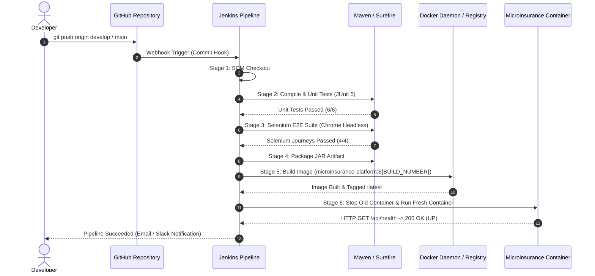

# Milestone 12: Jenkins-Docker Continuous Deployment
## Automated Microinsurance Enrollment Platform

---

### 1. End-to-End Commit-to-Container Architecture
The pipeline connects code pushes directly to fresh containerized deployments via automated continuous delivery:



---

### 2. Versioned Image & Registry Tagging Strategy
Each pipeline execution produces two tags:
1. **Immutable Build Tag:** `microinsurance-platform:${BUILD_NUMBER}` (e.g. `microinsurance-platform:14` for build #14). Guarantees exact rollback capability.
2. **Mutable Target Tag:** `microinsurance-platform:latest` (or `staging` / `production`).

#### Registry Verification Commands:
```bash
$ docker images | grep microinsurance-platform
microinsurance-platform   14        b102948ce71a   1 minute ago    218MB
microinsurance-platform   latest    b102948ce71a   1 minute ago    218MB
```

---

### 3. Automated Zero-Downtime Container Replacement Stage
```bash
# 1. Stop and remove prior running container
docker stop microinsurance-app || true
docker rm microinsurance-app || true

# 2. Launch updated container on specified environment port
docker run -d --name microinsurance-app \
    -p 8080:8080 \
    -e SPRING_PROFILES_ACTIVE=production \
    microinsurance-platform:14

# 3. Automated post-deployment health probe
echo "Verifying service readiness..."
for i in {1..10}; do
    curl -s -f http://localhost:8080/api/health && break
    sleep 3
done
```
